# BAAS AIO 安卓界面重构：原版 vs v3 对比说明

> 对比对象：原版 `509771e`（上游 main/dev）↔ 最终版 `compose-ui-v3` 分支（`4cf808f`）。
> 一句话：**界面从手写原生 View 换成了 Jetpack Compose，外观换成「Halo Sky」天空风格，功能、流程、数据格式和启用/禁用规则都和原版一致。**

## 1. 总览

| 项目 | 原版 | v3 |
|---|---|---|
| 界面技术 | 代码手写原生 View，`removeAllViews` 整页重建 | Jetpack Compose（原生弹窗保留，只换样式） |
| Activity 结构 | Home/Profile/Config/Schedule/Log/Preview | **完全相同**（类名、启动模式、横屏 PanePage 栈都没变） |
| 视觉 | 浅色、平台灰按钮 | 天空渐变 + 白卡片 + 品牌蓝渐变；深色模式 |
| 主题 | 只有浅色 | 跟随系统 / 浅色 / 深色，切换即时生效带淡入淡出 |
| 动效 | 无 | 底栏药丸、方向滑动、按压回弹、数字滚动、光带、呼吸点等 |
| 测试 | 无 | 10 个测试类、37 个用例（截图、状态切换、横屏布局等） |
| Debug APK | 187 MB | 204 MB（多出的主要是 Compose 的 dex） |

## 2. 代码量

**结论：代码变多了。** main 源码从 5429 行增加到 6638 行（+1209，+22%）；另外新增了 725 行测试。增加的主要是界面部分，非界面逻辑基本没变：

| 类别 | 原版 文件/代码行 | v3 文件/代码行 | 变化 |
|---|---|---|---|
| main 界面（UI） | 23 / 3460 | 26 / 4400 | **+940** |
| main 非界面（服务、IPC、存储、OCR） | 19 / 1795 | 19 / 1810 | +15 |
| 测试（test） | 0 / 0 | 10 / 645 | +645 |
| debug 源码 | 11 / 881 | 11 / 881 | 0 |
| Python | 14 / 1813 | 14 / 1813 | 0 |
| 资源 XML | 10 / 57 | 11 / 72 | +15 |

（"代码行"不含空行和注释；按物理行算，main 是 5429 → 6638。）

**为什么变多：**
1. **组件库**：原版直接用平台 Button/Switch/TextView；Compose 版要自己写 `BText`、`BButton`、开关、分段选择器、输入框、下拉框、滚动条等（`Ui.kt`、`Inputs.kt`、`Scrollbar.kt`，约 900 行）。
2. **v3 的视觉和动效**：主卡、悬浮底栏、数字滚轮、光带、预览顶栏方案 B 等（`HomeV3.kt`、`PreviewUi.kt`）。
3. **深色模式和主题切换**：`Appearance.kt`、颜色 getter、`values-night`。
4. **注释变多了**：踩过的坑都在代码里写了原因（这部分不算在"代码行"里）。
5. **测试**是新增的，原版没有。
6. **没有做 strings.xml 抽取**：文案仍写在代码里，和原版一样，所以资源 XML 几乎没变。

**git 统计**：`git diff --stat 509771e..compose-ui-v3` 共 49 个文件，+4360 / −1874 行；其中 app/src/main 34 个文件 +3097 / −1872，测试 10 个文件 +725。共 25 个提交。

### 逐文件明细（Kotlin/Java，不含 debug）

| 文件 | 类别 | 原版代码行 | v3 代码行 | 变化 | 状态 |
|---|---|---:|---:|---:|---|
| AboutDialog.kt | main-UI | 61 | 61 | +0 | 未变 |
| Appearance.kt | main-UI | 0 | 42 | +42 | 新增 |
| BaasInput.kt | main-UI | 29 | 29 | +0 | 未变 |
| ChoiceMenu.kt | main-UI | 39 | 38 | -1 | 修改 |
| CompanionBridge.kt | main-非UI | 131 | 131 | +0 | 未变 |
| ConfigActivity.kt | main-UI | 56 | 73 | +17 | 修改 |
| ConfigCatalog.kt | main-非UI | 58 | 58 | +0 | 未变 |
| ConfigForm.kt | main-UI | 270 | 301 | +31 | 修改 |
| FailureFrames.kt | main-非UI | 28 | 28 | +0 | 未变 |
| HomeActivity.kt | main-UI | 1059 | 1009 | -50 | 修改 |
| HomeV3.kt | main-UI | 0 | 242 | +242 | 新增 |
| Inputs.kt | main-UI | 0 | 162 | +162 | 新增 |
| LiveTask.kt | main-UI | 0 | 19 | +19 | 新增 |
| LogActivity.kt | main-UI | 53 | 56 | +3 | 修改 |
| LogFilters.kt | main-UI | 63 | 0 | -63 | 删除 |
| LogOutput.kt | main-UI | 53 | 0 | -53 | 删除 |
| LogViews.kt | main-UI | 0 | 144 | +144 | 新增 |
| ManagedMode.kt | main-非UI | 291 | 302 | +11 | 修改 |
| ManualTaskPanel.kt | main-UI | 170 | 147 | -23 | 修改 |
| ManualTasks.kt | main-非UI | 22 | 22 | +0 | 未变 |
| NativeOcr.kt | main-非UI | 9 | 9 | +0 | 未变 |
| NumberInput.kt | main-UI | 77 | 77 | +0 | 未变 |
| OcrService.kt | main-非UI | 29 | 29 | +0 | 未变 |
| OcrSession.kt | main-非UI | 42 | 42 | +0 | 未变 |
| PanePage.kt | main-UI | 86 | 103 | +17 | 修改 |
| PreviewActivity.kt | main-UI | 457 | 444 | -13 | 修改 |
| PreviewIdleActivity.kt | main-UI | 15 | 16 | +1 | 修改 |
| PreviewUi.kt | main-UI | 0 | 112 | +112 | 新增 |
| ProfileActivity.kt | main-UI | 129 | 166 | +37 | 修改 |
| ProfileResourcesView.kt | main-UI | 74 | 0 | -74 | 删除 |
| ProfileStore.kt | main-非UI | 339 | 339 | +0 | 未变 |
| ScheduleActivity.kt | main-UI | 162 | 185 | +23 | 修改 |
| ScheduleDrag.kt | main-UI | 122 | 0 | -122 | 删除 |
| ScheduleTable.kt | main-UI | 0 | 241 | +241 | 新增 |
| ScheduleTaskRow.kt | main-UI | 98 | 0 | -98 | 删除 |
| Scrollbar.kt | main-UI | 0 | 40 | +40 | 新增 |
| SettingsPanel.kt | main-UI | 93 | 103 | +10 | 修改 |
| ShizukuAccess.kt | main-非UI | 39 | 39 | +0 | 未变 |
| SocketBroker.kt | main-非UI | 258 | 258 | +0 | 未变 |
| TaskNotifications.kt | main-非UI | 109 | 109 | +0 | 未变 |
| TaskOrder.kt | main-非UI | 13 | 13 | +0 | 未变 |
| TaskRuntime.kt | main-非UI | 95 | 99 | +4 | 修改 |
| TaskService.kt | main-非UI | 290 | 290 | +0 | 未变 |
| Ui.kt | main-UI | 0 | 323 | +323 | 新增 |
| UiLogs.kt | main-UI | 41 | 0 | -41 | 删除 |
| UiNotice.kt | main-UI | 56 | 96 | +40 | 修改 |
| UiTheme.kt | main-UI | 197 | 171 | -26 | 修改 |
| WorkflowOcr.kt | main-非UI | 16 | 16 | +0 | 未变 |
| DebugTrace.kt | main-非UI | 8 | 8 | +0 | 未变 |
| DisplayDiagnostics.kt | main-非UI | 7 | 7 | +0 | 未变 |
| PreviewDiagnostics.kt | main-非UI | 11 | 11 | +0 | 未变 |
| DialogShotTest.kt | test | 0 | 40 | +40 | 新增 |
| IdleShotTest.kt | test | 0 | 26 | +26 | 新增 |
| LandscapeLayoutTest.kt | test | 0 | 47 | +47 | 新增 |
| MaterialDefaultButton.kt | test | 0 | 52 | +52 | 新增 |
| MotionTest.kt | test | 0 | 76 | +76 | 新增 |
| PreviewBarTest.kt | test | 0 | 95 | +95 | 新增 |
| ResourcesTest.kt | test | 0 | 140 | +140 | 新增 |
| ScheduleEchoTest.kt | test | 0 | 50 | +50 | 新增 |
| ShotTest.kt | test | 0 | 70 | +70 | 新增 |
| StateTransitionTest.kt | test | 0 | 49 | +49 | 新增 |

- **新增**：Appearance、HomeV3、Inputs、LiveTask、LogViews、PreviewUi、ScheduleTable、Scrollbar、Ui（main）；10 个测试文件；`baas_logo_ui.png`、`values-night/styles.xml`；文档 ORIGINAL-UI-SPEC.md、REFACTOR-LOG.md。
- **删除**（被 Compose 版替代）：LogFilters、LogOutput、ProfileResourcesView、ScheduleDrag、ScheduleTaskRow、UiLogs。
- **修改**：其余界面文件，以及 ManagedMode/TaskRuntime（加了可观察的状态版本号）、build.gradle.kts、gradle.properties。

## 3. 架构前后

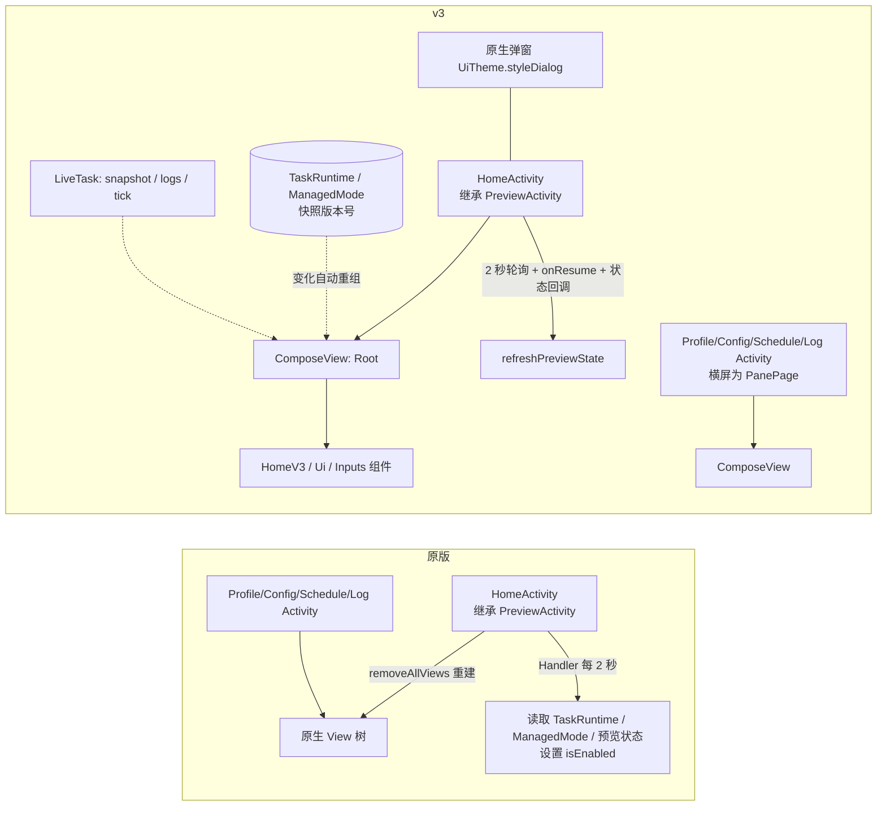

- Activity、PanePage、返回栈、onActivityResult、PreviewIdleActivity 的 taskAffinity、TaskService action、AIDL、Shizuku 用户服务、Python 调用全部没变。
- 状态：原版靠轮询设置按钮；v3 中 `TaskRuntime`、`ManagedMode` 内部带有 Compose 可观察的版本号，任何读取它们的界面都会在状态变化时立刻重算。

## 4. 各页面变化

### 主页
| 原版 | v3 浅色 | v3 深色 |
|---|---|---|
|  | 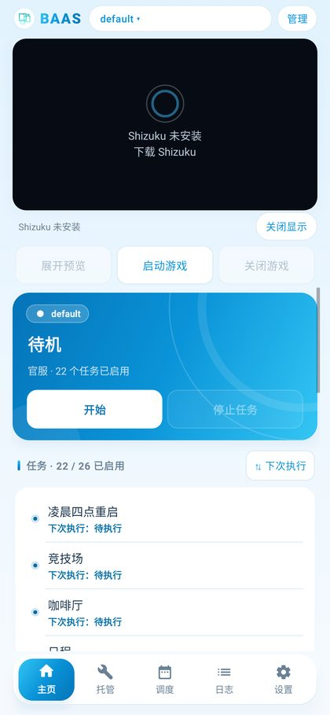 | 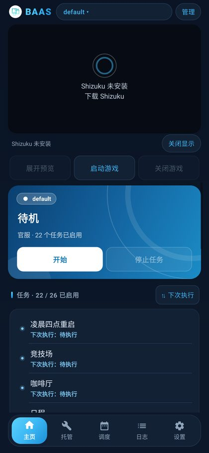 |

- 视觉：状态主卡（品牌渐变 + 光环纹理），呼吸状态点，运行中底部光带；任务列表卡片化；悬浮底栏。
- 行为：开始/停止任务、启动/关闭游戏、展开预览的启用规则与原版逐条一致。

### 托管
| 原版 | v3 浅色 | v3 深色 |
|---|---|---|
| 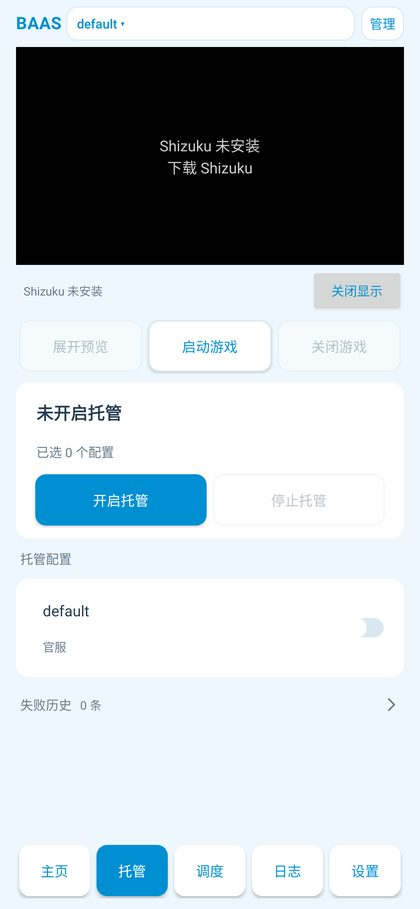 | 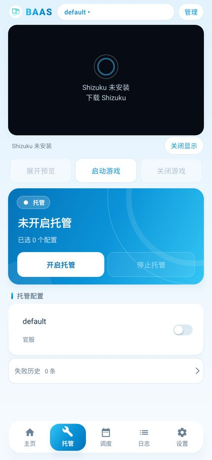 | 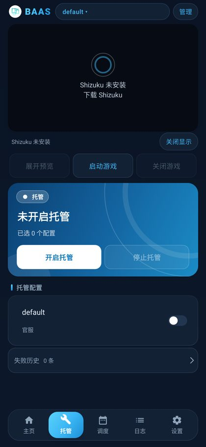 |

- 体力/信用点/青辉石做成小胶囊放在同一行，放不下时自动缩小字号，不出现省略号；打开开关时有机械滚轮动画。
- 托管运行且有任务在跑时，光带和呼吸点才会动。

### 调度
| 原版 | v3 浅色 | v3 深色 |
|---|---|---|
| 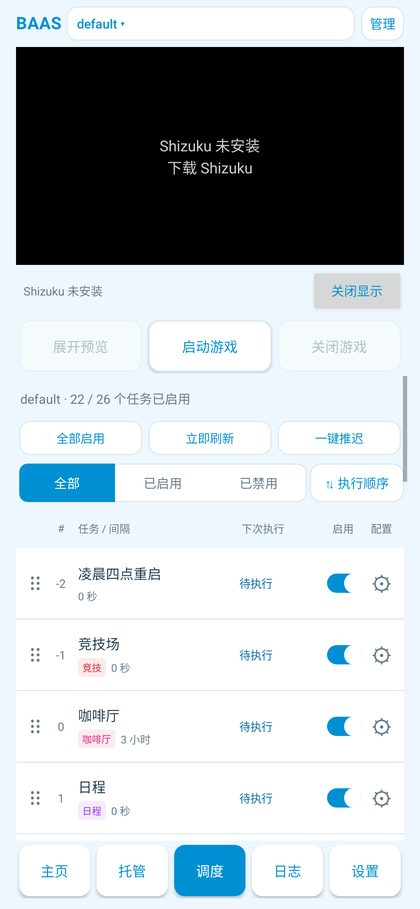 | 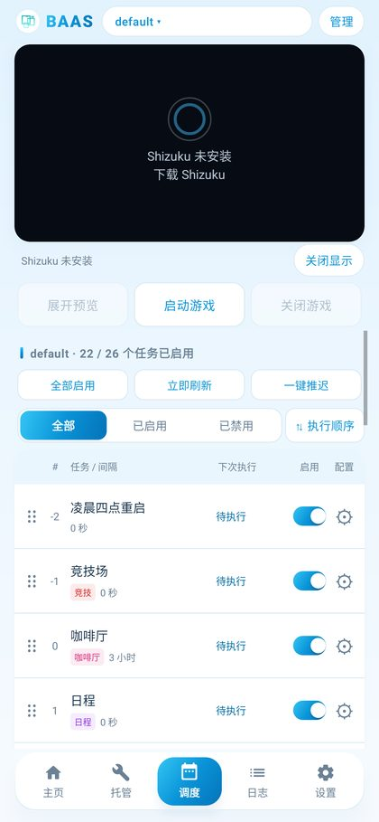 | 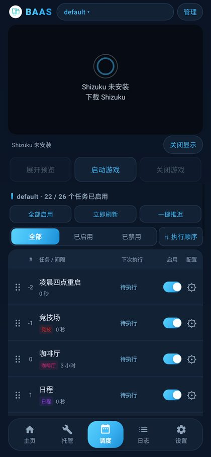 |

- 拖拽排序：被拖的行浮起，其他行平滑让位，带触觉反馈；"已保存"改为弹出的绿色小标签（出现和消失时机不变）。
- 调度编辑页：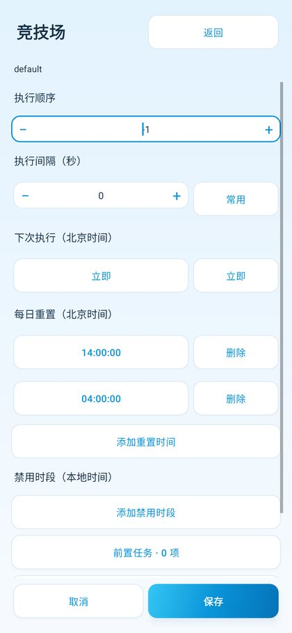

### 日志
| 原版 | v3 浅色 | v3 深色 |
|---|---|---|
| 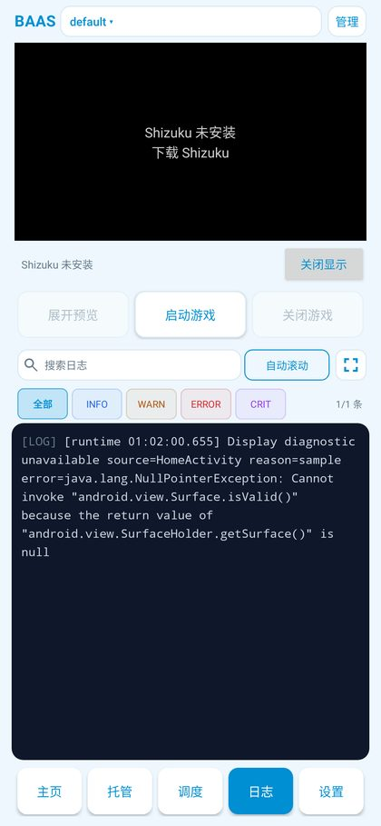 | 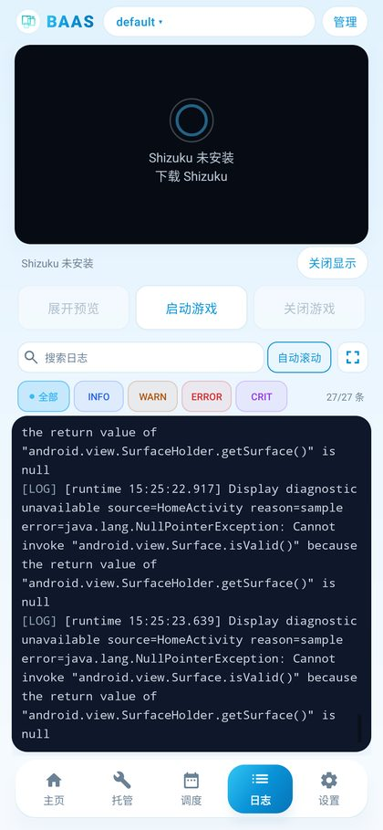 | 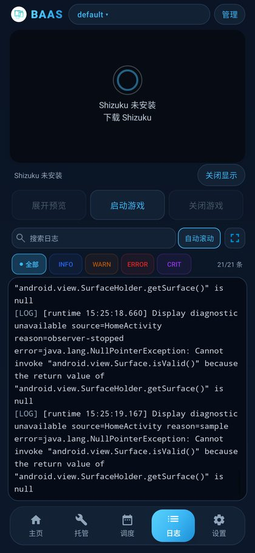 |

- 级别改成彩色小标签；搜索、筛选、自动跟随行为不变。全屏日志页：原版 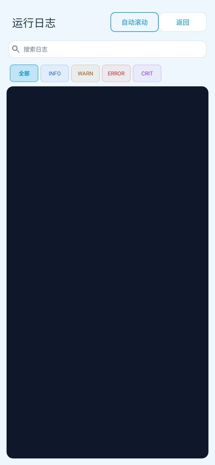 v3 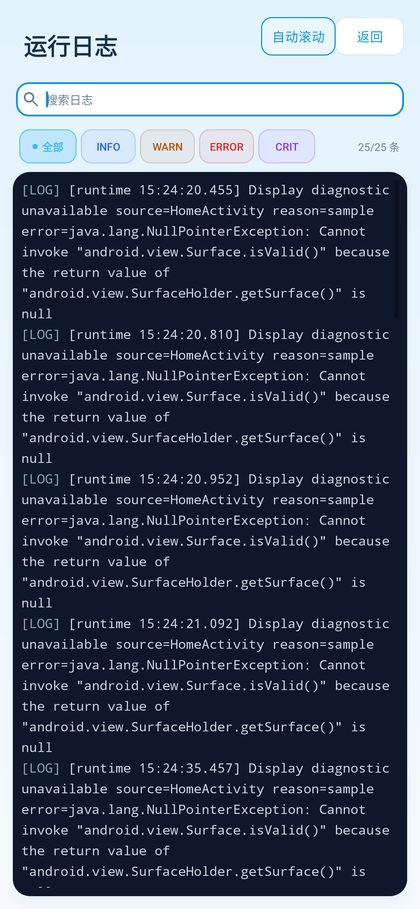

### 设置
| 原版 | v3 浅色 | v3 深色 |
|---|---|---|
| 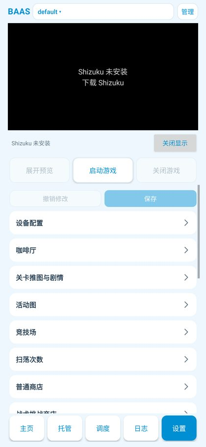 | 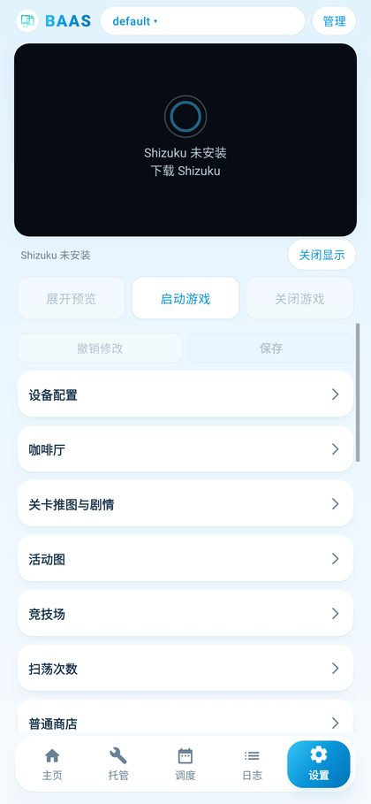 | 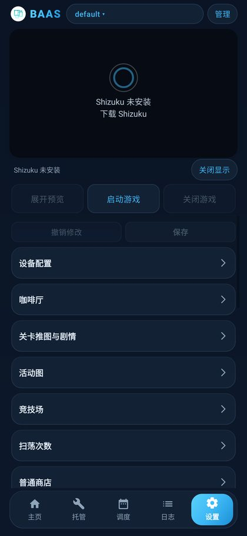 |

- 新增"外观"卡片（跟随系统/浅色/深色）。其余设置项、保存/撤销逻辑不变。配置设置页：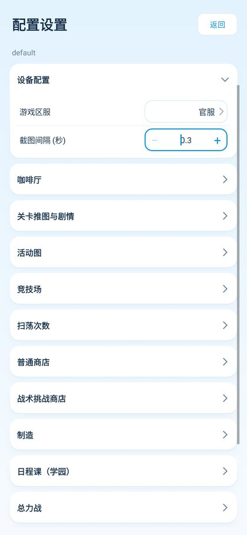

### 配置文件页
| 原版 | v3 |
|---|---|
| 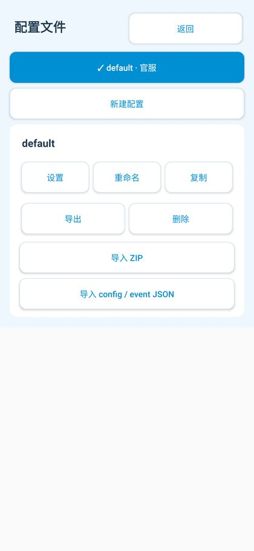 | 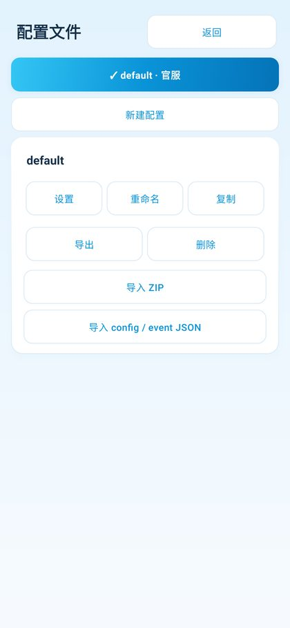 |

### 横屏
原版：
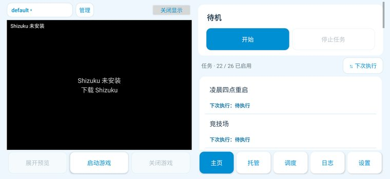

v3 浅色：
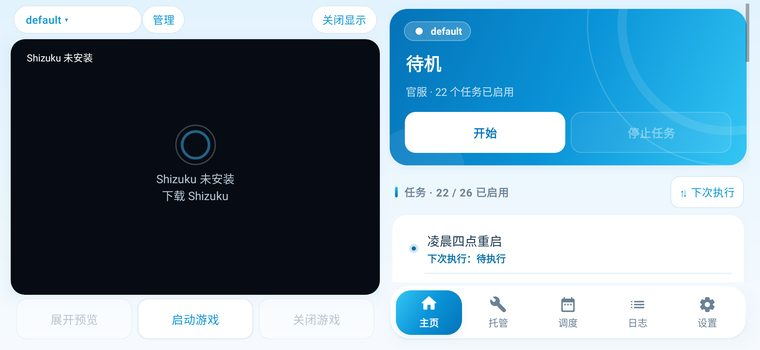

v3 深色：
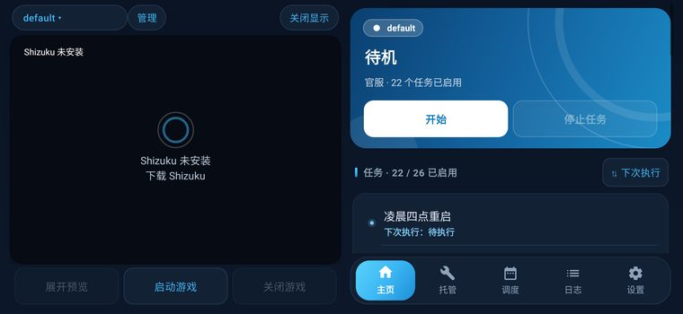

### 弹窗（以新建配置为例）
| 原版样式 | v3 浅色 | v3 深色 |
|---|---|---|
|  |  |  |

仍是原生弹窗，只换外观：圆角卡片、渐变主按钮；输入校验、回调、输入法逻辑不变。区服一行与名称输入框对齐。

### 全屏预览顶栏（方案 B）

贴顶居中的胶囊，状态区固定宽度，按钮出现时从右边展开、位置固定；文字放不下时跑马灯滚动（前面留 12dp 空隙，首字不被渐隐）。只有按钮区接收点击，其余触摸直达游戏。

## 5. 保持不变的行为

- 所有按钮的启用/禁用规则（逐条对照 509771e，见 README-HANDOFF 的状态表）。
- Activity 类名、启动模式、`configChanges`、PanePage 横屏栈、返回键行为、跳转不闪屏。
- 2 秒轮询节奏，"· 已保存"提示的时机。
- 配置、event.json、托管偏好、失败记录、导入导出格式。
- TaskService action、AIDL `ISocketBroker`、Shizuku 用户服务参数、Python 调用接口、debug 入口。
- 每日重置的北京时间 ⇄ UTC 换算、间隔 -1 = 一次性等细节。
- 509771e 的 Shizuku 授权串行化修复（通知权限先于 Shizuku 授权）。

## 6. 新功能

1. **主题切换**：跟随系统/浅色/深色，即时生效、280ms 淡入淡出，启动时第一帧就是正确主题。
2. **Halo Sky 视觉**：天空渐变、品牌蓝渐变、柔和蓝色阴影、真实 BAAS Logo。
3. **动效**：底栏药丸弹簧滑动、Tab 按方向滑动、按压回弹、分段选择器滑块、开关动画、拖拽浮起。
4. **数字滚动**：状态文字、资源数值像里程表一样滚动；打开资源显示时播放一次"从 9 滚到真实数值"的机械滚轮动画。
5. **运行指示**：状态卡底部光带 + 呼吸状态点。
6. **全屏预览顶栏方案 B** + 跑马灯。
7. **细滚动条**：照原版 ScrollView 的显示和淡出时机复刻。

## 7. 真机测试中发现并修复的问题

| 问题 | 原因 | 修复 |
|---|---|---|
| 调度编辑点"立即"不回显 | 字段区没读刷新计数，Compose 跳过了重绘 | 字段区读取刷新计数；加回归测试 |
| 青辉石被截断 | 三项平分宽度 | 按内容分配宽度，放不下自动缩字号 |
| 切 Tab 瞬间资源闪"—" | 滑出的页面被重建，读数清空 | 读数缓存到 Activity 级 |
| 滚轮动画结束时数字缩一下 | 滚动时和停下后用了两套渲染 | 始终用同一个滚轮渲染器 |
| 跑马灯首字被渐隐 | 渐隐区盖住首字 | 首字前留 12dp 空隙 |
| 弹窗还是原生样式、区服没对齐 | 未统一样式 | `styleDialog` 统一 + 对齐 |
| 托管开→关后"启动游戏"一直灰 | 托管/任务状态不可观察，界面不重算 | 状态带可观察版本号；关托管、resume 时立即刷新预览状态 |
| 横屏时预览铺满全屏（手动深色/浅色） | 主题实现把启动时的整份配置（含方向）锁死了 | 只覆盖深浅色；同时按实际窗口宽高判断横竖屏 |
| APK 279 MB | 增量打包留下约 75 MB 空洞 | 每次打包前删掉旧 APK → 204 MB |

## 8. 已知限制 / 需要真机确认

- 不同设备的字号/显示大小设置下，资源数字可能比截图小一号（与设备相关，暂不处理）。
- 游戏在 App 外被关掉、而你没切回 App 时，"启动游戏"按钮要等 2 秒轮询才恢复。
- 横竖屏旋转的完整流程（测试环境只能直接以横屏启动来验证排版）。
- 低端机（Android 9）上阴影和动画帧率；触觉反馈强度；刘海屏横屏边距。
- 时间选择器深色下的灰色表头是系统控件自带的，改不了。
- 切换 Tab 是否完全不闪（截图测试测不出透明度问题）。

## 9. 后续想法

- **自定义 RGB 呼吸灯**：状态卡光带和呼吸点的颜色、速度做成设置项。
- 暂停时光带改成更慢、偏黄的样式（目前保持原样：任务暂停时游戏仍开着，所以光带继续走）。
- 文案抽取到 strings.xml，为多语言做准备。
- 外部关闭游戏的即时感知（监听进程而不是轮询）。
