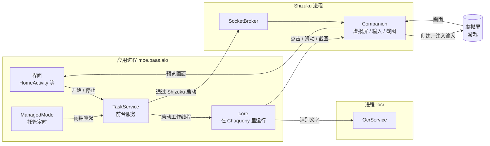

# 架构

BAAS AIO 不改写 BAAS 的业务代码。选哪些任务、什么时候执行、怎么执行，都交给 core 决定。应用自己只做四件事：界面、操作设备、OCR 和按时唤起。

## 界面

界面用 Jetpack Compose 编写。

| Activity | 作用 |
| --- | --- |
| `HomeActivity` | 启动入口，里面有主页、托管、调度、日志、设置五个页面 |
| `ProfileActivity` | 管理配置：新建、复制、重命名、删除、导入、导出 |
| `ConfigActivity` | 编辑一个配置的各项设置 |
| `ScheduleActivity` | 编辑单个任务的调度，也能打开它的执行参数 |
| `LogActivity` | 全屏日志 |
| `PreviewActivity` | 横屏看游戏画面，也可以手动操作 |
| `PreviewIdleActivity` | 虚拟屏刚建好、游戏还没启动时显示的占位页 |
| `RestartActivity` | 在单独的 `:restart` 进程里运行，换 core 后由它结束旧进程、重新打开应用 |

调试版还有 `MainActivity` 等诊断页面，代码在 `app/src/debug/`。

## 配置文件

每个配置存成一个文件夹 `files/profiles/<id>/`，里面有三个文件：

- `config.json` 和 `event.json`：BAAS 原本的格式，分别是设置和任务列表。
- `profile.json`：应用自己用的，记下配置名称和区服。

读写都经过 `ProfileStore`。任务配置和调度仍然由 BAAS 说了算。

区服和游戏包名的对应关系写在 `ProfileStore.Profile` 里，目前支持官服、B服、日服和国际服。

## TaskService 和 Python 代码

`TaskService` 是前台服务，类型是 `specialUse`。任务运行时，它持有 Python 工作线程、OCR 会话和设备连接。

Python 代码在 `app/src/main/python/`：

| 模块 | 作用 |
| --- | --- |
| `core_loader.py` | 决定这个进程用内置版本还是下载的 core 包，并负责新 core 的自检和回退 |
| `core_check.py` | 新 core 第一次启动时的自检 |
| `core_task.py` | 接上安卓的设备和输出，运行 BAAS 原本的入口 |
| `platform_bindings.py` | 替换掉只有桌面端才有的 IO 模块 |
| `android_bindings.py` | 安卓这边的 IO，包括 OCR |
| `companion_device.py` | BAAS 的设备层，点击、滑动和截图都通过 Companion 完成 |
| `managed_schedule.py` | 托管时分批运行选中的配置，复用 BAAS 的调度 |
| `profile_migration.py` | 新 core 增加任务或字段时，合并进已有的 `event.json` |
| `resource_refresh.py` | 借用 core 的主页识别，刷新体力等资源数量 |

内置版本放在 APK 的 `assets/baas-source.zip` 里。第一次运行时解压到 `files/baas-core/`，并逐个校验哈希。下载的 core 包放在 `files/core/ext/`，详见 [core-updates.md](core-updates.md)。

## Companion 和 Shizuku

Shizuku 启动并授权后，设备控制由手机独立完成，无需电脑常驻连接。Android 10 无 Root 时，启动 Shizuku 通常仍需要电脑 ADB。控制链路如下：

1. 应用通过 Shizuku 的 UserService 启动 `SocketBroker`，它运行在有 Shizuku 权限的进程里。
2. `SocketBroker` 持有 `companion-runtime` 里的 `CompanionUserService`。
3. 应用和 Companion 用本地 socket 通信。每条消息是 4 字节大端长度加一段 JSON，后面可以跟二进制数据。
4. Companion 用 `VirtualDisplayController` 创建名为 `baas-aio` 的虚拟屏，把游戏启动到上面，再往里注入点击、滑动、按键和双指缩放。
5. 截图取自虚拟屏的 Surface，由 `NativeCaptureBridge` 采集。

游戏跑在虚拟屏上，所以手机锁屏不会直接打断托管。

## OCR

OCR 在单独的 `:ocr` 进程里运行，由 `OcrService` 提供，工作线程里的 `OcrSession` 会绑定它。

底层是 BAAS 的安卓 OCR 预编译库，通过 JNI 桥接库 `libbaas_aio_ocr.so` 调用，源码在 `app/src/main/cpp/ocr_bridge.cpp`。

OCR 模型打包在 `assets/ocr-resources.zip`。它和 `baas-source.zip` 一样，由 `BundledAssets` 复制到应用私有目录，只有装了新 APK 才会重新复制。

## 游戏预览

主页上方的预览区和 `PreviewActivity` 显示虚拟屏的实时画面。

预览和 BAAS 的截图各走各的通道，开关预览不会影响任务。任务暂停时，可以直接在预览上手动操作。

## 托管模式

`ManagedMode` 管什么时候唤起，BAAS 管唤起后执行哪些任务。

- 下次唤起用 `AlarmManager.setAlarmClock` 设置。Android 12 及以上需要“闹钟和提醒”权限。
- 开机、应用更新、时区或时间变化、闹钟权限变化之后，`ManagedReceiver` 会重新设置闹钟。
- 唤起后由 `TaskService` 运行选中的配置。
- 某个配置失败了，会隔一段时间再试。还是失败就挂起，等用户手动重试。
- “托管前唤醒解锁”是全局开关，默认关闭。关闭时不会点亮屏幕。

## 一个进程只选一次 core

Python 和 Kotlin 在同一个进程里只选一次 core。所以换了 core 之后，必须重启进程才生效，这也是 `RestartActivity` 存在的原因。
